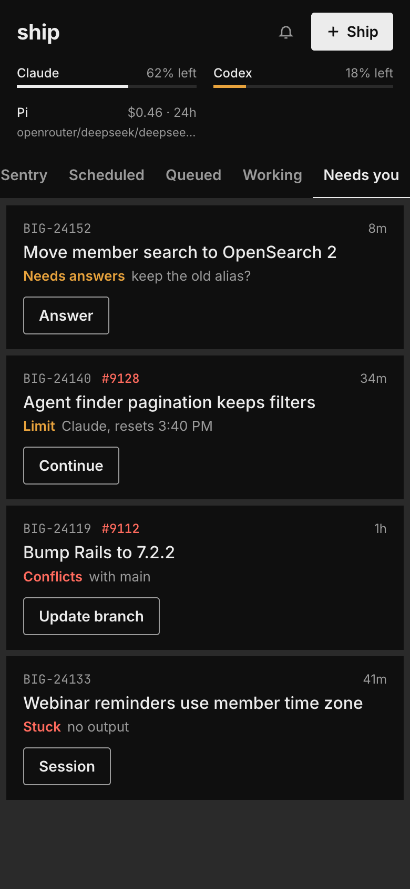
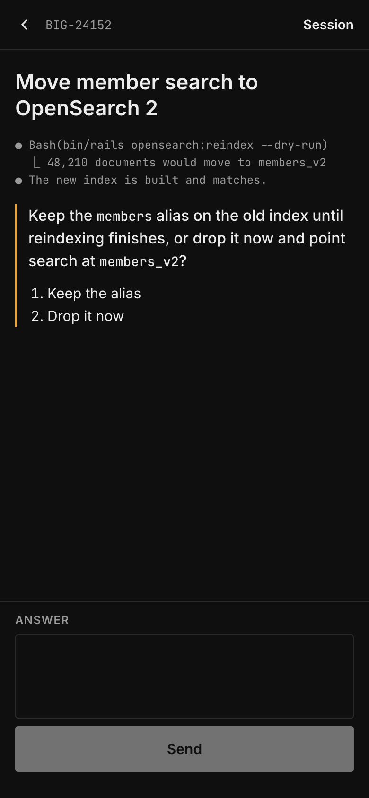
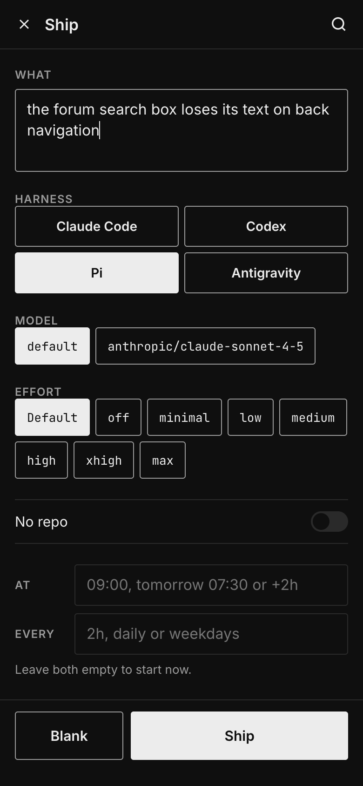

A few weeks after I wrote about [`ship`](/dev/2026/10/07/ship-unattended-claude-code-sessions.html), Claude Code got a `/ship` of its own. It's a nice built-in, with some useful subcommands. It also took the name from my skill. I typed `/ship BIG-12345` and got Anthropic's version instead of mine.

Getting mine back took two tries. The first fix was the obvious one: set `"skillOverrides": {"ship-local": "off"}` in `~/.claude/settings.json`. That hid the built-in, but the built-in still held the `/ship` name, so my skill never loaded either. I had no `/ship` at all until a second session dug through the Claude Code binary and found the real switch:

```json
{
  "env": {
    "CLAUDE_CODE_DISABLE_SHIP": "1"
  }
}
```

With that set, the built-in never registers and a user skill named `ship` loads like it used to. If you have your own `/ship`, that's the setting you want.

That fight seemed like a good excuse to look at how much `ship` itself has changed. Since the first post it has had a little over 200 commits. Most are small, but three changes matter most: it isn't tied to Claude anymore, it reviews its own work with Codex, and it works from my phone.

## Any harness, any model

When I wrote the first post, `ship` meant Claude Code. Now a run can go to one of four harnesses: Claude Code, OpenAI's Codex CLI, the [Pi coding agent](https://www.npmjs.com/package/@earendil-works/pi-coding-agent), or Google's Antigravity CLI.

```sh
ship --harness codex --model gpt-5.5 BIG-12345
ship --harness pi --model openrouter/anthropic/claude-sonnet-4.5 BIG-12345
ship --harness antigravity BIG-12345
ship --model opus --effort high BIG-12345
```

Pi is the one that opened things up. Pi doesn't come with a model of its own. It talks to any provider you sign in to, so a run can use anything `pi --list-models` shows, including pay-as-you-go models like DeepSeek through OpenRouter. The ship wizard pulls that list in and makes it searchable. Since those models bill per call, the dashboard adds up what Pi spent in the last 24 hours, by model, next to the Claude and Codex usage meters.

Getting the other harnesses to behave like Claude took most of the work. Codex, Pi and Antigravity can't load Claude Code's skills or plugins, so their prompts say where each `SKILL.md` is and tell them to read and follow it, and to treat the repo's `CLAUDE.md` like an `AGENTS.md` or `GEMINI.md`. Nothing wakes them up once a turn ends, so they're told to wait on CI and review inside the turn. The watcher reads each harness's transcript format to find the context size and whether the session is between turns, so it can still type `/compact` when a session gets long. It doesn't matter which agent is in the pane.

The most useful part of having four harnesses is the usage limit. When a session hits its limit, the watcher marks the run `Limit` and it moves to Needs you. `c` asks which harness, model and effort should continue it. Pick a different one and `ship` quits the stuck harness and starts the run again in the same worktree, picking up from what the run recorded. A Claude limit at 2pm no longer means the ticket waits until the limit resets.

## Codex reviews every PR

I use Codex for more than running tickets. Every `ship` session now opens its PR, then runs `codex review` against the target branch, fixes what it finds, pushes, and reviews again until nothing worth fixing is left. If Codex is out of credits, the same diff goes to `claude -p` instead, and the PR description says which one reviewed it. A finding the session decides is wrong goes in the description too, so the human reviewer can see the call it made.

That way a second model has read the diff before any of my teammates see the PR.

## From my phone, over Tailscale

The big change in how I use `ship` is that I don't need to be at my laptop. Most of what the dashboard asks of me is small: answer a question, continue a run, update a branch. None of that needs a keyboard.

The first step was making `ship status` work in a narrow terminal. Under 80 columns it turns into a list of cards, every dialog has buttons because a phone keyboard has no Esc, and links reached over SSH go to the phone's clipboard instead of opening a browser on the Mac.

That works, but a TUI over SSH on a phone is still a TUI over SSH on a phone. So `ship web` serves the same board as a small web app, and [`tailscale serve`](https://tailscale.com/kb/1312/serve) puts it on my tailnet:

```sh
ship web                  # http://127.0.0.1:8787
tailscale serve --bg 8787 # https://<machine>.<tailnet>.ts.net
```

The server only listens on localhost and has no login, because Tailscale handles that part. Only my own devices can reach it, and each request names who sent it. On an iPhone, Add to Home Screen turns it into an app that can send notifications, so my phone buzzes when a run needs an answer, hits a usage limit, gets stuck, or is ready to merge.

<p style="display: flex; flex-wrap: wrap; gap: 12px;">
  
  
  
</p>

*Demo data. The tickets and PRs are made up.*

From left to right: the board opens on Needs you, with the Claude and Codex usage meters and Pi's 24-hour cost at the top. A question from a session looks like a chat message, and I answer it in a sentence. The Ship screen takes a ticket or a plain description, with the harness, model and effort to use, and an At or Every field to schedule it for later. There's also a real terminal (xterm.js, with a key bar for Esc, Tab, arrows and Ctrl) when I need to get into a session's tmux pane directly.

This is how I want to work with these agents. A question shows up, I answer it in ten seconds from wherever I am, and the run keeps going.

## Smaller things

A few other changes worth mentioning:

- **Scheduling.** `ship --at 09:00` and `ship --every weekdays --at 09:00` run work later or on a schedule, from the CLI, the dashboard or the phone.
- **A kanban board.** `ship status` is now columns (Sentry, Scheduled, Queued, Working, Needs you, In review, Ready, Done) instead of a table.
- **A session limit.** Work past ten open sessions waits in a queue and starts when one closes.
- **No more auto-ship.** I took out the every-15-minutes Jira poll. I pick what gets shipped now.
- **Jira without MCP.** `ship` talks to Jira's API directly, through one small package.
- **Blockers first.** Shipping a ticket ships the tickets that block it first.

## Still mine

Everything from the first post still applies. It's closed source, it's built around how I work, and most of these changes were worked on by `ship` sessions themselves.

The `/ship` name clash was a good reminder that when you build your own tools on someone else's platform, the platform can change under you. It took a couple of sessions and one environment variable to sort out, which is a small price for a tool that does exactly what I want.
